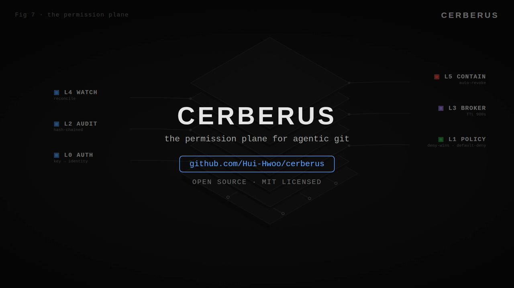

# Cerberus

**The policy gatekeeper for AI agents on Cloudflare Artifacts.**

Cloudflare Artifacts gives every agent a Git remote — but its tokens are repo-wide
`read`/`write` only. An agent asked to update docs can technically rewrite `src/auth/`
and push to `main`, and nothing stops it except prompt obedience. Prompt obedience
is not a security boundary.

Cerberus sits between agents and Artifacts as the **exclusive token minter**:
every Git operation an agent wants goes through a policy check first.
Path-level rules, branch protection, privilege-escalation approvals, and a full
audit trail — the access-control layer Cloudflare's own best-practices doc asks
for but its API can't express.

```
  agent ──"I need to push src/api/** to branch feat-x"──▶ Cerberus Worker
                                                            │ policy check
                                    ┌─── DENY (+reason, logged)
                                    │
                                    └─── ALLOW ──▶ mint repo.createToken("write", 900s)
                                                         │  (short-lived, repo-scoped)
                                                         ▼
                                              git push via Artifacts remote
```

## Why this exists

- Artifacts tokens are **repo-scoped read/write only** — no path or branch granularity
  ([Workers binding docs](https://developers.cloudflare.com/artifacts/api/workers-binding/)).
- Official best practices say "mint the narrowest token you can, for the shortest
  time you can" — but there's no engine that *decides* what's narrow enough.
- With N agents pushing concurrently, "trust the prompt" doesn't scale.
  GitHub learned this with branch protection and fine-grained PATs; agents need it more.

## What's inside

| Part | What it does |
|---|---|
| `src/policy.ts` | Pure policy engine: ordered rules, glob matching on paths/branches/repos, explicit-deny-wins, default-deny |
| `src/auth.ts` | Agent authentication: pre-shared Bearer keys bound to identity (`agentId` + `roles`); identity never comes from the request body |
| `src/broker.ts` | Exclusive token minter wrapping the Artifacts binding (`createToken` / `revokeToken`, signatures verified against official docs 2026-10-09) |
| `src/audit.ts` | Every decision logged (D1 in production, in-memory for local/demo); SHA-256 hash-chained, concurrency-safe appends |
| `src/watch.ts` | Post-hoc reconciliation: Artifacts repo events (via Queue) cross-checked against the decision log; unmatched pushes flagged UNEXPLAINED and trigger containment (auto-revoke of write tokens). Single-use: one decision explains at most one push. Content-aware: changed files must fall within the decision's declared paths |
| `src/index.ts` | Worker routes (see API below) + audit UI at `/` |
| `policy.example.json` | Example policy: docs-writer, backend-dev, release-manager roles |
| `keys.example.json` | Example agent-key registry (shape only — never commit real keys) |
| `demo/` | Scripted-agent harness: policy scenarios, full lifecycle vs mock binding, policy linter |

## Quickstart (no Cloudflare account needed)

```bash
npm install
npm run demo         # 14 policy scenarios → decision metrics
npm run lifecycle    # 65-check full request lifecycle vs mock binding
npm run lint:policy  # validate policy.example.json (or pass your own)
```

## API

All mutating routes require `Authorization: Bearer <agent-key>`.
Keys are provisioned via the `AGENT_KEYS_JSON` secret (see Deploy); the key
— not the request body — determines `agentId` and `roles`.

```
POST /v1/token                 policy check → mint (or 403 / 202 requireApproval)
POST /v1/elevate               open an elevation ticket for your own requireApproval decision
POST /v1/elevate/:id/approve   approver key only → narrow short-lived token (TTL ≤ 300s)
POST /v1/elevate/:id/reject    approver key only
GET  /v1/elevations?status=    list tickets (public read)
POST /v1/revoke                kill switch: revoke a token (any valid key)
GET  /v1/decisions?limit=      audit trail (public read)
GET  /v1/events?limit=       observed repo activity + reconciliation verdicts (public read)
GET  /v1/verify                hash-chain tamper check: { ok, badIndex, checked }
POST /v1/admin/repos           admin key only — create a repo (demo helper; disable in prod)
POST /v1/admin/notify-test     admin key only — send a test payload to NOTIFY_WEBHOOK_URL
GET  /                         audit UI: decisions, pending elevations, observed activity
```

Decisions carry an advisory `severity` (`info`/`low`/`medium`/`high`/`critical`;
display/filter only, never changes the outcome): normal allows are `info`,
main-branch denials are `high`. A burst of ≥5 denials by one agent in 60s
writes an advisory `probing_suspected` record at `critical` — it flags, never
blocks. Request paths are canonicalized before policy matching: `..` segments
are resolved and any path escaping the repo root is denied fail-closed, so
`docs/../../infra/secrets/key` can never match a `docs/**` allow-rule.

Ticket notifications: set the `NOTIFY_WEBHOOK_URL` secret and Cerberus POSTs a
signed JSON payload on every elevation ticket (`elevation.created` with
approve/reject URLs); optional `NOTIFY_WEBHOOK_SECRET` enables the
`x-cerberus-signature` HMAC header. Delivery is best-effort and fail-open —
the ticket, not the notification, is the record of truth.

Example:

```bash
KEY=<agent-docs-1-key>
curl -X POST https://<worker>/v1/token \
  -H "Authorization: Bearer $KEY" -H "content-type: application/json" \
  -d '{"taskId":"t1","action":"push","repo":"website","branch":"docs/faq","paths":["docs/faq.md"]}'
# → {"allowed":true,"token":"…","expiresAt":"…","scope":"write","ttlSeconds":900,"decisionId":"…"}

# use the minted token with any git client:
git -c http.extraHeader="Authorization: Bearer $TOKEN" push origin docs/faq
```

## Deploy

Prerequisites: Cloudflare account with **Workers Paid** ($5/mo — Artifacts
requirement), `wrangler` logged in (`npx wrangler login`).

**Fast path:** `./setup.sh` does steps 1–7 below in one go (override with
`WORKER_NAME=… NAMESPACE=… DEMO_REPO=…`). The manual steps follow for
transparency.

```bash
# 1. Audit database
npx wrangler d1 create cerberus-audit
# → put the returned database_id into wrangler.jsonc

# 2. Schema (decisions + elevations + repo_events)
npx wrangler d1 execute cerberus-audit --remote --file=schema.sql

# 3. Policy (your rules live here, not in code)
npx wrangler secret put POLICY_JSON < policy.example.json

# 4. Agent keys — who may call the gate, and as whom.
#    Generate secrets, e.g.:
#      python3 -c "import secrets; print('cbk_'+secrets.token_hex(16))"
#    Write keys.json in the shape of keys.example.json:
#      {"keys":{"<secret>":{"agentId":"agent-docs-1","roles":["docs-writer"]},
#               "<secret>":{"agentId":"agent-rel-1","roles":["release-manager"],"canApprove":true},
#               "<secret>":{"agentId":"admin","roles":["admin"],"canApprove":true,"isAdmin":true}}}
npx wrangler secret put AGENT_KEYS_JSON < keys.json
#    NEVER commit keys.json. Rotate with the same command.

# 5. Event queue + subscription (post-hoc reconciliation).
#    Must exist before deploy so the Worker can attach as consumer
#    (consumer is declared in wrangler.jsonc).
npx wrangler queues create cerberus-events
npx wrangler queues subscription create cerberus-events \
  --source artifacts.repo --source-namespace <namespace> --source-repo-name <repo> \
  --events pushed,token.created,token.revoked \
  --name cerberus-watch

# 6. Deploy
npm run deploy   # → https://cerberus-gatekeeper.<account>.workers.dev

# 7. Smoke test
curl -s https://<worker>/v1/verify
# → {"ok":true,"badIndex":-1,"checked":0}
curl -s -X POST https://<worker>/v1/token \
  -H "Authorization: Bearer <docs-key>" -H "content-type: application/json" \
  -d '{"taskId":"smoke","action":"push","repo":"<repo>","branch":"docs/faq","paths":["docs/faq.md"]}'
# → {"allowed":true,"token":"…",…}
```

What you get: the policy gate at `/v1/token`, the audit UI at `/`,
hash-chained tamper-evident decisions in D1, and a Queue consumer that
reconciles every push/token event against the decision log (unmatched
pushes surface as UNEXPLAINED in the UI).

### Production notes

- **Disable `POST /v1/admin/repos`** (demo-only repo provisioning) or keep it
  behind the admin key and IP allowlisting.
- **Rotate keys** with `wrangler secret put AGENT_KEYS_JSON`; revoking a
  key instantly deauthorizes its agent (outstanding Artifacts tokens are
  auto-revoked on the next UNEXPLAINED push, or revoke individually via
  `POST /v1/revoke`).
- **Alert on UNEXPLAINED**: poll `GET /v1/events` (or the `unexplained`
  counter) — a push with no matching allow-decision means something
  bypassed the broker.
- **Containment is automatic**: on an UNEXPLAINED push the watcher revokes
  every outstanding write token on the repo (tens of seconds after the push
  lands — event-delivery dependent, not a fixed SLA).
  Read tokens are spared. This bounds the breach to the detection window
  — it does not limit it to a single push, and it cannot undo
  pushes that already landed.
  Reconciliation is single-use: one allow-decision explains at most one
  push, so a bypass cannot piggyback on a recent legitimate approval.
- **Content verification**: a push is marked explained only if its changed
  files (diffed from before/after commit trees, fork-point resolved for new
  branches) fall within the decision's declared paths. Minting for
  `docs/**` and pushing `src/auth/**` to the same branch is flagged as a
  content violation → unexplained → containment. Known boundary: when the
  tree diff cannot be determined, the push is marked explained with
  `contentVerified: false` (branch + single-use matching still apply) —
  a fail-open edge on path-scoped decisions, flagged in the event detail
  rather than hidden.
- **Verify the chain**: `GET /v1/verify` — any tampering with the D1
  audit table breaks the hash chain and is reported with the index.
- Tokens are repo-scoped bearer tokens: enforcement happens at mint time.
  The Queue watcher is defense-in-depth (detect + disarm, tens of seconds
  latency depending on event delivery),
  not a replacement for the gate. Residual limitation: a bypass that
  lands within the window of a legitimate outstanding approval for the
  same branch may be misattributed as explained — inherent to bearer
  tokens without push→token attribution in Artifacts events, and the
  reason scoped tokens belong on Cloudflare's roadmap.

## Demo video

[](https://github.com/Hui-Hwoo/cerberus/releases/download/v1.0.0/cerberus-demo-final.mp4)

6:36 — from the problem (a poisoned agent walks into `src/auth/`) through
the six-layer permission plane: policy decisions, real Artifacts token
minting, watcher reconciliation, multi-agent concurrency, and quorum
elevation. Every number on screen comes from the live system.

> Maintainer: create a GitHub Release tagged `v1.0.0`, attach
> `cerberus-demo-final.mp4` (29.7 MB), and the link above works.
> Thumbnail: `docs/demo-thumbnail.png`.

## Security

See [SECURITY.md](SECURITY.md). Highlights:

- **Authenticated agents**: Bearer keys bound to identity; roles are never
  self-asserted. Keys support optional `expiresAt` (expired → 401,
  unparseable → 503 fail-closed). No key → 401; misconfigured key
  store → 503 fail-closed.
- **Fail-closed** on any internal error: never mint on error, never fail open.
- **SHA-256 hash-chained tamper-evident audit log**, concurrency-safe
  (UNIQUE chain invariant + retry); verifiable live via `GET /v1/verify`.
  Every decision is stamped with the active policy's hash, so a silent
  policy change is visible in the audit trail.
- **Audit-before-mint**: the decision record is written before any token
  exists — no orphan tokens.
- **Short-TTL least-privilege tokens** (default 900s, elevation ≤ 300s),
  per-token kill switch (`POST /v1/revoke`).
- **Elevation with quorum**: `requireApproval` decisions need human sign-off.
  `elevationQuorum` (default 1) sets how many *distinct* approvers are
  required — the requester can never approve their own ticket, and the
  same agent can't approve twice. Set to 2+ and no single key can
  unilaterally grant elevated access.
- **Post-hoc reconciliation**: Queue-delivered repo events cross-checked
  against decisions (branch + actual changed content); bypass pushes
  flagged UNEXPLAINED, outstanding write tokens revoked — with a
  per-repo 5-minute containment cooldown so the safety system itself
  can't be weaponized into a DoS loop.
- Default-deny with `observe` mode for policy assessment: would-deny
  decisions are logged with a flag instead of silently blocking, so you can
  preview impact from the decision log before enforcing. (Note: observe
  still returns 403 — it is an assessment mode, not a pass-through.
  True pass-through observe is on the roadmap.)

## License

MIT. See [LICENSE](LICENSE).
